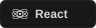
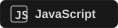
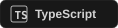
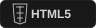

### Thoughtful design. Solid code.

Web &amp; mobile experiences, built with care.

  &nbsp;
  &nbsp;
  

  
  
  
  

 

<h2></h2>

I'm **Leo Lawrence M. Galve**, an Information Technology student and full-stack
developer focused on building web and mobile products that make everyday work
clearer and easier.

**Clear interfaces. Reliable systems. Useful software.** 
I build clear, responsive interfaces and dependable systems for web and mobile.
From the screens people use to the APIs and data that support them, I enjoy
bringing each part together into a complete, easy-to-use product. I pay close
attention to the details, keep the experience consistent, and aim to make
software that solves real needs and works reliably every day.

 

<h2></h2>

Interfaces &amp; experiences

  
  
  
  
  
  

APIs &amp; data

  
  
  
  
  
  
  

Mobile, motion &amp; workflow

  
  
  
  
  

 

<h2></h2>

**SMaRT-PDM** · Scholarship Management and Records Tracking 
A team project for the Office for Scholarship and Financial Assistance at Pambayang Dalubhasaan ng Marilao.

 

<h2></h2>

  

  

  

 

<a href="mailto:galveleolawrence@gmail.com">galveleolawrence@gmail.com</a> &nbsp; / &nbsp; <a href="https://github.com/lolesciax">@lolesciax on GitHub</a>

