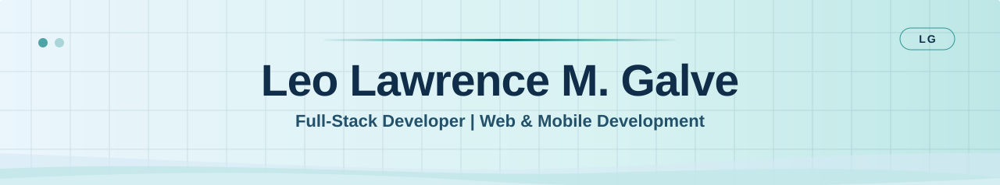



<picture>
  <source media="(prefers-color-scheme: dark)" srcset="./profile-banner-dark.svg">
  <source media="(prefers-color-scheme: light)" srcset="./profile-banner-light.svg">
  
</picture>

### Hi, I'm Leo 👋

**Information Technology student · Full-stack developer · UI/UX-focused builder**

I build web and mobile applications that connect clear interfaces with practical workflows.

**[View my portfolio](https://lawrencegalve.vercel.app)** · [Explore my Windows 11 portfolio](https://leolawrencegalve.vercel.app) · [Email me](mailto:galveleolawrence@gmail.com)

[About](#about-me) · [Projects](#selected-projects) · [Tech stack](#tech-stack) · [Connect](#lets-connect)

## About me

I enjoy turning everyday processes into software that's useful and easy to navigate. My work spans interface design, application logic, APIs, and database integration, with a focus on responsive layouts and maintainable code.

I've worked on a full-stack thrift store, collaborated on a scholarship management platform for web and Android, and explored interactive 3D experiences in the browser.

- **What I care about:** accessible interfaces, reusable components, and clear user workflows.
- **How I work:** design thoughtfully, build iteratively, and improve through debugging and feedback.
- **Where I'm headed:** growing in full-stack development and contributing to meaningful software projects with a team.

## Selected projects

### 01 / SMaRT-PDM

**Scholarship Management and Records Tracking**

A team-developed platform for the Office for Scholarship and Financial Assistance at Pambayang Dalubhasaan ng Marilao. It supports scholarship applications, scholar monitoring and renewals, administrative workflows, reporting, and OCR-assisted document review across web and Android interfaces.

**Built with:** React, Node.js, Express, Flutter, PostgreSQL, Supabase, Python, and Tesseract OCR.

[Explore the repository →](https://github.com/lolesciax/SMaRT-PDM)

### 02 / Old Goods Thrift OMS

**E-commerce and order management**

A secondhand clothing store project with a React storefront and an administrative workspace. Features include product browsing, favorites, shopping carts, checkout workflows, inventory management, orders, and discounts.

**Built with:** React, Vite, Tailwind CSS, Python, Flask, and MongoDB.

[Explore the repository →](https://github.com/lolesciax/OMS-REACT)

### 03 / KOBIS

**Interactive 3D web development**

A React project exploring 3D experiences in the browser with Three.js and React Three Fiber.

**Built with:** React, Three.js, and React Three Fiber.

[Explore the repository →](https://github.com/lolesciax/KOBIS)

## Tech stack

  
  
  
  
  
  

| Area | Technologies |
| :--- | :--- |
| Frontend | React, JavaScript, HTML, CSS, Tailwind CSS, Vite |
| Backend & APIs | Node.js, Express, Python, Flask |
| Databases & services | PostgreSQL, Supabase, MongoDB |
| Mobile | Flutter, Dart |
| 3D & workflow | Three.js, React Three Fiber, Git, GitHub |

## Two ways to explore my work

| Portfolio | What you'll find |
| :--- | :--- |
| [Main portfolio](https://lawrencegalve.vercel.app) | My projects, skills, and development work in a focused presentation. |
| [Windows 11 portfolio](https://leolawrencegalve.vercel.app) | An alternative portfolio experience inspired by the Windows 11 desktop. |

The main portfolio is also available through a [Cloudflare Workers mirror](https://portfolio.laureinzogalve.workers.dev).

## Let's connect

I'm interested in opportunities to build useful software, collaborate with other developers, and keep learning through hands-on work.

**[Send me an email](mailto:galveleolawrence@gmail.com)** · [Browse all repositories](https://github.com/lolesciax?tab=repositories)

Thoughtful interfaces. Practical systems. Always learning.

