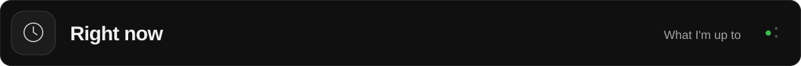

### Thoughtful design. Solid code.

Web &amp; mobile experiences, built with care.

  &nbsp;
  &nbsp;
  

  
  
  
  
  

 

<h2></h2>

I'm **Leo Lawrence M. Galve**, an Information Technology student and full-stack
developer. I turn everyday workflows into thoughtful web and mobile experiences.

**I like making the complicated feel clear.** 
I work across interfaces, APIs, and data to build web and mobile experiences
that are useful, considered, and easy to navigate. Outside that, I'm drawn to
desktop-inspired UI and interactive 3D.

 

<h2></h2>

🔨 &nbsp; **Building** — Finishing SMaRT-PDM features and polishing the UI 
📖 &nbsp; **Learning** — Deepening TypeScript patterns and server-side rendering 
🎯 &nbsp; **Exploring** — Desktop-style web interfaces and 3D on the browser 
🌱 &nbsp; **Growing** — Writing cleaner code, one refactor at a time

 

<h2></h2>

<table>
  <tbody>
    <tr>
      <td width="25%" valign="middle">01 / INTERFACE <strong>Interfaces &amp; experiences</strong></td>
      <td valign="middle">
        
        
        
        
        
        
      </td>
    </tr>
    <tr>
      <td width="25%" valign="middle">02 / ENGINEERING <strong>APIs &amp; data</strong></td>
      <td valign="middle">
        
        
        
        
        
        
        
      </td>
    </tr>
    <tr>
      <td width="25%" valign="middle">03 / MOBILE + MOTION <strong>Mobile &amp; workflow</strong></td>
      <td valign="middle">
        
        
        
        
        
      </td>
    </tr>
  </tbody>
</table>

 

<h2></h2>

**SMaRT-PDM** · Scholarship Management and Records Tracking 
A team project for the Office for Scholarship and Financial Assistance at Pambayang Dalubhasaan ng Marilao.

 

<h2></h2>

  

  

  

 

<a href="mailto:galveleolawrence@gmail.com">galveleolawrence@gmail.com</a> &nbsp; / &nbsp; <a href="https://github.com/lolesciax">@lolesciax on GitHub</a>

