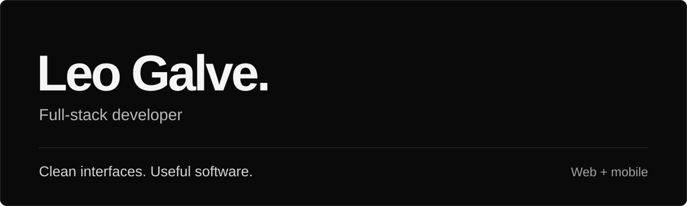
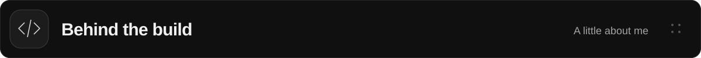
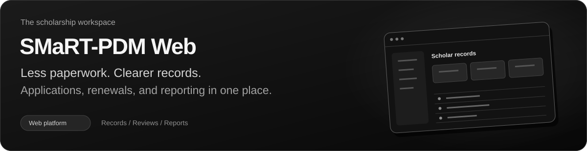
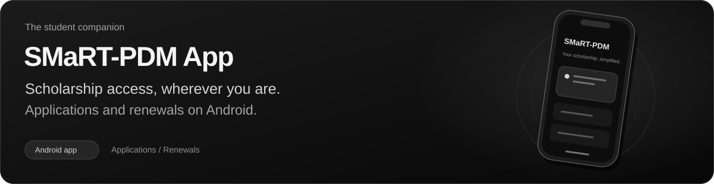
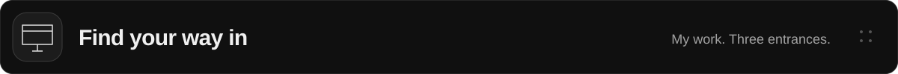
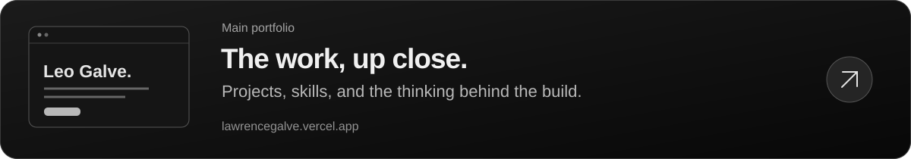
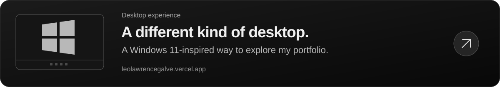
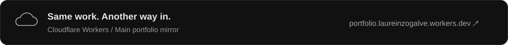

### Build with purpose. Keep it simple.

Web & mobile development, with an eye for the details.

  &nbsp;
  &nbsp;
  

<a href="#about">About</a> &nbsp; / &nbsp; <a href="#tech-stack">Tech stack</a> &nbsp; / &nbsp; <a href="#selected-work">Selected work</a> &nbsp; / &nbsp; <a href="#beyond-the-code">Portfolios</a>

 

<h2></h2>

I'm **Leo Lawrence M. Galve**, an Information Technology student and full-stack
developer. I turn everyday workflows into thoughtful web and mobile experiences.

**Design that feels clear. Systems that work together.** 
From responsive interfaces to APIs and databases, I enjoy connecting the pieces.
I also explore desktop-inspired interfaces and interactive 3D on the web.

 

<h2></h2>

Interfaces & experiences

  
  
  
  
  
  

APIs & data

  
  
  
  
  
  
  

Mobile, motion & workflow

  
  
  
  
  

 

<h2></h2>

**SMaRT-PDM** · Scholarship Management and Records Tracking 
A team project for the Office for Scholarship and Financial Assistance at Pambayang Dalubhasaan ng Marilao.

 

<h2></h2>

  

  

  

 

<a href="mailto:galveleolawrence@gmail.com">galveleolawrence@gmail.com</a> &nbsp; / &nbsp; <a href="https://github.com/lolesciax">@lolesciax on GitHub</a>

